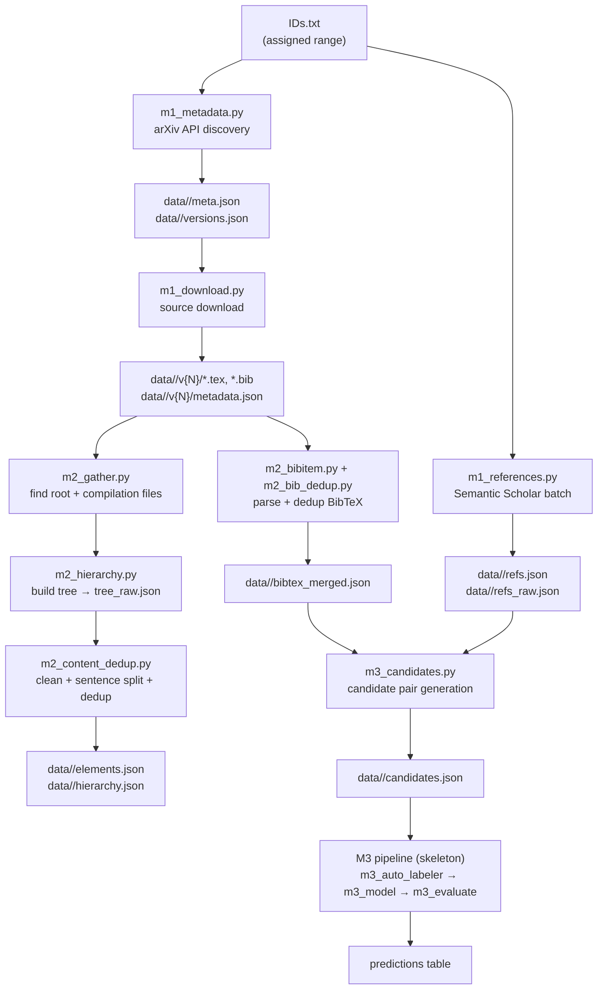

# System Architecture

## Repository layout

```
arxiv-project/
├── src/
│   ├── run_m1.py               # M1 integrated entry point
│   ├── run_m2.py               # M2 BibTeX + candidate pipeline entry point
│   ├── run_m3.py               # M3 skeleton (not yet implemented)
│   ├── crawler/
│   │   ├── m1_metadata.py      # arXiv API → meta.json + versions.json
│   │   ├── m1_download.py      # source archive download + extraction
│   │   └── m1_references.py    # Semantic Scholar reference crawl
│   ├── parser/
│   │   ├── m2_gather.py        # find root .tex + collect compilation path
│   │   ├── m2_hierarchy.py     # build section/paragraph/sentence tree
│   │   ├── m2_cleanup.py       # LaTeX cleanup + math normalization
│   │   ├── m2_sentences.py     # sentence splitting
│   │   ├── m2_bibitem.py       # parse BibTeX entries from .bib files
│   │   ├── m2_bib_dedup.py     # dedup + rewrite \\cite keys
│   │   ├── m2_content_dedup.py # cross-version element dedup → elements.json + hierarchy.json
│   │   └── m2_export_parquet.py # write Parquet tables for M2
│   ├── matching/
│   │   ├── m3_candidates.py    # generate BibTeX↔reference candidate pairs
│   │   ├── m3_auto_labeler.py  # skeleton
│   │   ├── m3_string_features.py # skeleton
│   │   ├── m3_context_features.py # skeleton
│   │   ├── m3_model.py         # skeleton
│   │   ├── m3_evaluate.py      # skeleton
│   │   ├── m3_predictions.py   # skeleton
│   │   └── m3_publish_hf.py    # skeleton
│   ├── utils/
│   │   ├── config.py           # shared paths, ID helpers, API config
│   │   ├── benchmark.py        # PerfRecorder + ResourceMonitor
│   │   └── schemas.py          # PyArrow schemas for all 6 tables
│   └── tests/
│       └── ...                 # 14 pytest tests (all passing)
├── docs/                       # this documentation
├── data/                       # output data (not committed)
├── requirements.txt
└── README.md
```

---

## Data flow



---

## Key design principles

**Filesystem as integration layer.** There is no database. Each module reads and writes files at paths defined in `utils/config.py`. This keeps modules independent: M2 does not import M1 at runtime.

**Atomic writes.** Every JSON output is first written to a `.tmp` file and then renamed. This prevents partially-written files from being read by later stages or by a resumed run.

**Checkpoint/resume.** Both M1 download and M2 processing skip a version/paper when the expected output file already exists. If a run is interrupted, restart the same command and it continues from where it left off.

**Rate-limit compliance.** arXiv requires ≥ 3 seconds between requests (enforced in `m1_download.polite_wait` and `arxiv.Client(delay_seconds=3.0)`). Semantic Scholar without an API key allows ~100 requests per 5 minutes; with a key it allows 1 request/second.

---

## Path naming conventions

`utils/config.py` defines every path. The two key conventions to understand:

| Convention | Example | Used for |
|------------|---------|----------|
| `paper_key(id)` | `2310.12345` → `2310-12345`, `hep-th/9901001` → `hep-th-9901001` | **folder names** (`data/<paper_key>/`) |
| raw `arxiv_id` | `2310.12345` | **inside JSON files** (never use paper_key in data fields) |

The `run_m1.py` integrated runner uses its own `folder_name()` which does the same thing (`.` → `-`, `/` → `_`) but with a different separator for `/`. This creates a slight inconsistency with the standalone `m1_download.py` output layout. See [06_integration.md](06_integration.md) for details.

---

## External APIs

| API | Endpoint | Rate limit | Config |
|-----|----------|-----------|--------|
| arXiv metadata | `http://export.arxiv.org/api/query` | 3 s between calls | `C.ARXIV_DELAY_SECONDS = 3.0` |
| arXiv source | `https://export.arxiv.org/src/{id}v{N}` | 3 s between calls | `C.ARXIV_SRC_URL` |
| Semantic Scholar single | `https://api.semanticscholar.org/graph/v1/paper/arXiv:{id}` | 1 req/s (key) or ~0.33 req/s (no key) | `C.S2_API_URL` |
| Semantic Scholar batch | `https://api.semanticscholar.org/graph/v1/paper/batch` | same | `m1_references.BATCH_URL` |
