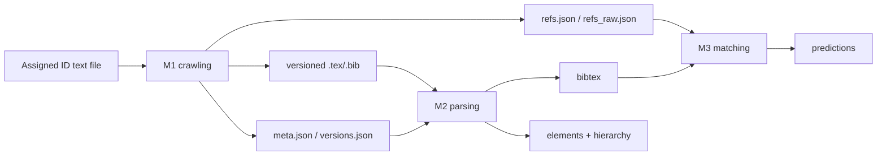

# System architecture

## High-level architecture



The filesystem is the integration layer. `utils.config` supplies shared paths and identifier conventions for implemented M1 modules and is intended for all later stages. External services are arXiv and Semantic Scholar. There is no database layer.

The team plan adds two delivery layers around the code pipeline: Jupyter Book
builds for milestone reports and Hugging Face publication for the final
dataset/model. An A2 poster is the final presentation artifact. These
deliverables are project requirements, but their build/publish automation is
not present in the checked-out source.

## Verified M1 flow

`run_m1.main` reads and deduplicates IDs, discovers latest versions and dates, starts one bounded Semantic Scholar batch future, downloads source versions serially, joins the reference future, writes outputs, and records performance metrics. This is bounded overlap, not parallel arXiv downloading.

## Intended later flow

```text
M1 → gather → hierarchy → cleanup/sentence splitting
   → BibTeX extraction/deduplication → content deduplication → Parquet
   → labels/features/model → predictions/evaluation → publishing
```

`run_m2.py` and `run_m3.py` are skeletons on `main`; the later flow is therefore a design contract rather than an executable pipeline.

## Architecture review

- Confirm whether the integrated `run_m1.py` output layout should replace the standalone crawler layout: `[TEAM INPUT REQUIRED]`
- Confirm final orchestration owner and CLI contract: `[TEAM INPUT REQUIRED]`
- The agreed development schedule is intentionally overlapped across M1, M2,
  and M3 rather than strictly sequential: verified from the team plan.

---
