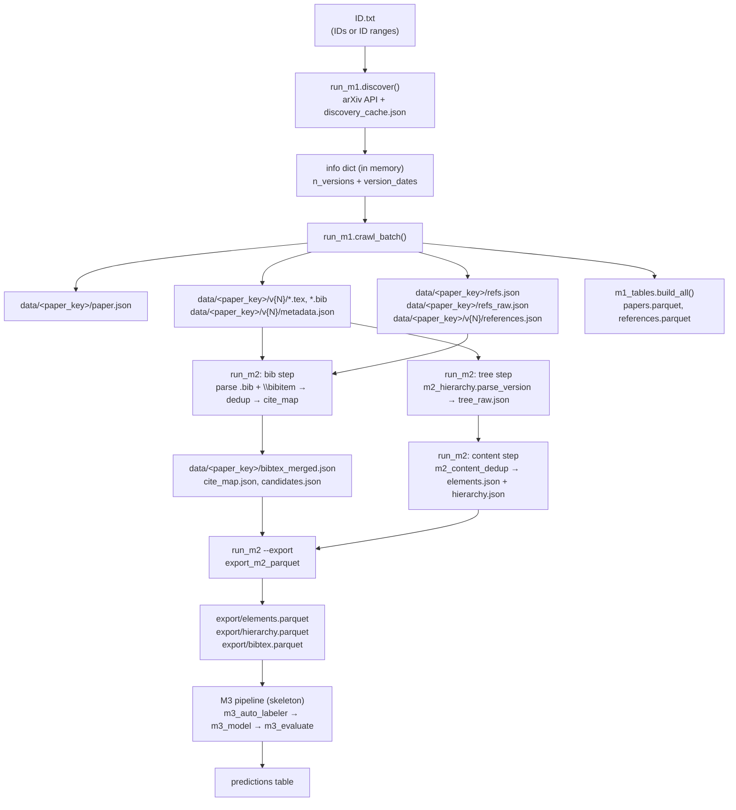

# System Architecture

## Repository layout

```
arxiv-project/
├── src/
│   ├── run_m1.py               # M1 integrated entry point
│   ├── run_m2.py               # M2 pipeline: bib → tree → content (+ --export)
│   ├── run_m3.py               # M3 skeleton (not yet implemented)
│   ├── crawler/
│   │   ├── m1_download.py      # source archive download + extraction (library only)
│   │   ├── m1_references.py    # Semantic Scholar reference crawl
│   │   ├── m1_tables.py        # build papers/references Parquet + CSV
│   │   └── m1_aggregate.py     # merge multi-session benchmark logs
│   ├── parser/
│   │   ├── m2_gather.py        # find root .tex + collect compilation path
│   │   ├── m2_hierarchy.py     # build section/paragraph/sentence tree
│   │   ├── m2_cleanup.py       # LaTeX cleanup, macro expansion, math normalization
│   │   ├── m2_sentences.py     # sentence splitting
│   │   ├── m2_bibitem.py       # parse .bib files AND inline \bibitem
│   │   ├── m2_bib_dedup.py     # dedup + rewrite \\cite keys
│   │   ├── m2_content_dedup.py # cross-version element dedup → elements.json + hierarchy.json
│   │   ├── m2_inspect.py       # human-readable dump of one paper's M2 output
│   │   └── m2_pick_papers.py   # list papers suitable for M3 manual labeling
│   ├── matching/
│   │   ├── m3_candidates.py    # generate BibTeX↔reference candidate pairs
│   │   ├── m3_pick_papers.py   # same selection logic as m2_pick_papers
│   │   ├── m3_auto_labeler.py  # skeleton
│   │   ├── m3_string_features.py # skeleton
│   │   ├── m3_context_features.py # skeleton
│   │   ├── m3_model.py         # skeleton
│   │   ├── m3_evaluate.py      # skeleton
│   │   ├── m3_predictions.py   # skeleton
│   │   └── m3_publish_hf.py    # skeleton
│   ├── utils/
│   │   ├── config.py           # shared paths, ID helpers, API config
│   │   ├── logger.py           # shared pipeline formatter and logger setup
│   │   ├── benchmark.py        # PerfRecorder + ResourceMonitor
│   │   └── schemas.py          # PyArrow schemas + export_m2_parquet
│   └── tests/                  # 10 test files (164 tests, all passing — see 07)
├── docs/
├── data/                       # output data (not committed)
├── requirements.txt
├── README.md
└── README_M2.md                # collaborator's M2 deep-dive
```

> **Removed since the previous doc revision:** `crawler/m1_metadata.py` and
> `parser/m2_export_parquet.py` were deleted upstream. Discovery and version
> enumeration now live inside `run_m1.py`; Parquet export moved into
> `run_m2.py --export`, which calls `utils.schemas.export_m2_parquet`.

---

## Data flow



`run_m2` drives all three M2 steps itself (`bib`, `tree`, `content`) plus
optional `--export`, closing the old "`run_m2` never calls `m2_hierarchy`" gap.

---

## Key design principles

**Filesystem as integration layer.** There is no database. Each module reads and writes files at paths defined in `utils/config.py`. This keeps modules independent: M2 does not import M1 at runtime.

**Atomic writes.** Every JSON output is first written to a `.tmp` file and then renamed. This prevents partially-written files from being read by later stages or by a resumed run.

**Checkpoint/resume.** Both M1 download and M2 processing skip a version/paper when the expected output file already exists. If a run is interrupted, restart the same command and it continues from where it left off.

**Rate-limit compliance.** arXiv requires ≥ 3 seconds between requests (enforced in `m1_download.polite_wait` and `arxiv.Client(delay_seconds=3.0)`). Semantic Scholar without an API key allows ~100 requests per 5 minutes; with a key it allows 1 request/second.

---

## Path naming conventions

`utils/config.py` defines every path. The two key conventions to understand:

| Convention | Example | Used for |
|------------|---------|----------|
| `paper_key(id)` | `2310.12345` → `2310-12345`, `hep-th/9901001` → `hep-th-9901001` | **folder names** (`data/<paper_key>/`) |
| raw `arxiv_id` | `2310.12345` | **inside JSON files** (never use paper_key in data fields) |

`run_m1.folder_name()` is now a one-line delegate to `C.paper_key()`, so the two
naming schemes that used to diverge (`.` → `-` vs `.` → `-`, `/` → `_` vs `/` → `-`)
are unified. That closes the old §4.1 defect in
[06_integration.md](06_integration.md); old-style IDs like `hep-th/9901001` now
resolve to the same directory everywhere.

M2 never trusts the directory name to recover the ID. `run_m2.paper_arxiv_id()`
and `m2_hierarchy.read_arxiv_id()` both read `paper.json`, because
`2602-04870` cannot be turned back into `2602.04870` or `hep-th/9901001`.

---

## External APIs

| API | Endpoint | Rate limit | Config |
| ----- | ---------- | ----------- | -------- |
| arXiv metadata | `http://export.arxiv.org/api/query` | 3 s between calls | `C.ARXIV_DELAY_SECONDS = 3.0` |
| arXiv source | `https://export.arxiv.org/src/{id}v{N}` | 3 s between calls | `C.ARXIV_SRC_URL` |
| Semantic Scholar single | `https://api.semanticscholar.org/graph/v1/paper/arXiv:{id}` | 1 req/s (key) or ~0.33 req/s (no key) | `C.S2_API_URL` |
| Semantic Scholar batch | `https://api.semanticscholar.org/graph/v1/paper/batch` | same | `m1_references.BATCH_URL` |

Only `export.arxiv.org` is used. `arxiv.org/src/...` returns HTTP 403, and
`m1_download.BASE_URL` is hardcoded to the export mirror for that reason.
