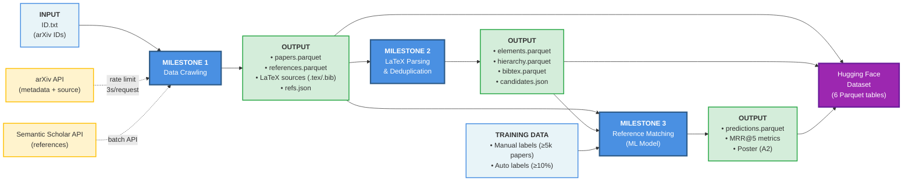
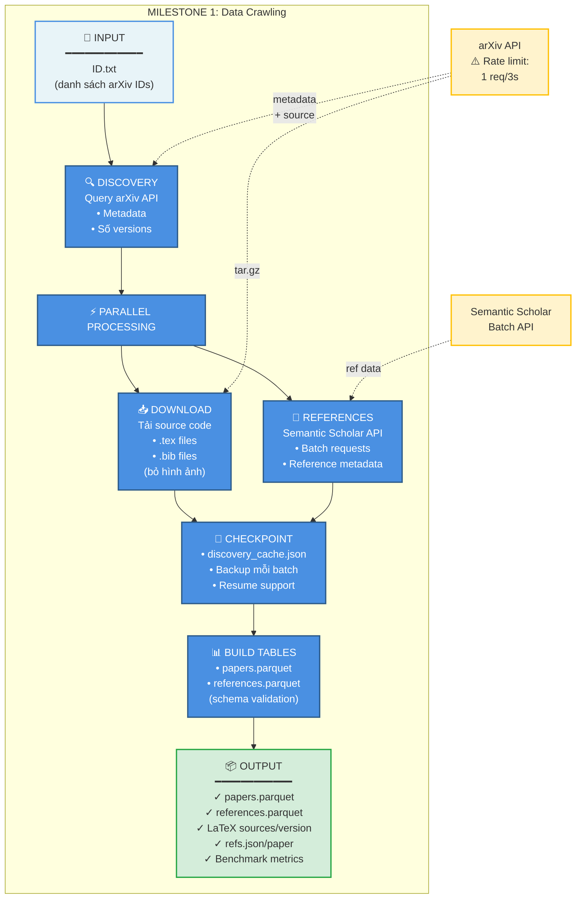
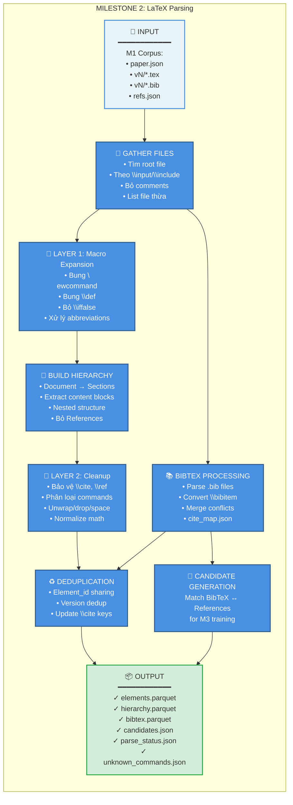
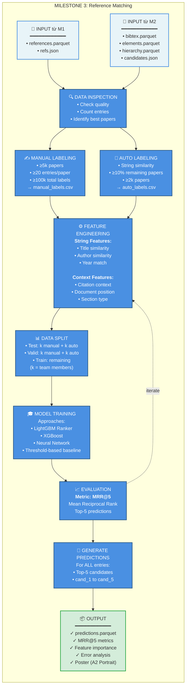

# High-Level Architecture - arXiv Research Paper Processing Pipeline

## 📊 Tổng Quan Kiến Trúc

Đồ án xây dựng pipeline xử lý và phân tích bài báo khoa học từ arXiv, bao gồm 3 milestone chính với luồng dữ liệu liên tiếp:



---

## 🔄 Chi Tiết Từng Milestone

### Milestone 1: Data Crawling & Collection

**Mục tiêu:** Thu thập dữ liệu thô từ arXiv và Semantic Scholar



**Đặc điểm kỹ thuật:**
- **Thời gian ước tính:** 20,000 IDs ≈ 28-45 giờ (3-4 phiên Colab)
- **Resume:** Discovery cache + checkpoint theo version
- **Backup:** Tarball nhanh 10-20x so với rsync (2-5 phút restore)
- **Tuân thủ:** arXiv ToS (1 connection, 3s delay, proper User-Agent)

---

### Milestone 2: LaTeX Parsing & Deduplication

**Mục tiêu:** Parse LaTeX thành cấu trúc và khử trùng nội dung



**Kiến trúc hai tầng xử lý LaTeX:**
1. **Tầng 1 (Pre-tree):** Bung macro do tác giả định nghĩa
2. **Tầng 2 (Post-tree):** Bảo vệ, phân loại, bóc vỏ dự phòng

**Đầu ra chính:**
- `elements`: Nội dung đã dedup (sentence, formula, heading...)
- `hierarchy`: Cấu trúc cây từng version
- `bibtex`: BibTeX entries sau merge và dedup

---

### Milestone 3: Reference Matching with ML

**Mục tiêu:** Match BibTeX entries với references bằng ML model



**Công thức MRR@5:**
```
MRR@5 = (1/|Q|) × Σ(1/rank_i)

Trong đó:
- |Q| = số labeled entries trong test set
- rank_i = vị trí correct reference trong top-5 (1-5)
- rank_i = 0 nếu không có trong top-5
```

**Feature Ideas:**
- String similarity: Levenshtein, Jaccard, SequenceMatcher
- TF-IDF cosine similarity
- Author name overlap (normalized)
- Year difference
- Exact title match (binary)
- Citation context từ hierarchy

---

## 📊 Pipeline Metrics Tổng Hợp

### M1 Benchmark
| Metric | Giá trị |
|--------|---------|
| Thời gian | 28-45h (20k IDs) |
| RAM đỉnh | ~12 GB (Colab) |
| Disk đỉnh | ~50 GB |
| Success rate | >99% |
| Backup speed | 2-5 phút restore |

### M2 Benchmark
| Metric | Giá trị |
|--------|---------|
| Parse success | >95% |
| Dedup reduction | ~30-40% |
| Unknown commands | →0 (goal) |
| Processing | CPU only |
| Version coverage | Multi-version aware |

### M3 Target
| Metric | Target |
|--------|--------|
| MRR@5 | Maximize |
| Manual labels | ≥100k entries |
| Auto labels | ≥10% papers |
| Test fairness | k+k papers |

---

## 🗂️ Final Dataset Structure

```
Hugging Face Dataset
├── 📊 M1 Tables
│   ├── papers.parquet
│   │   └── Columns: arxiv_id, title, authors, submission_date, revised_dates, venue
│   └── references.parquet
│       └── Columns: arxiv_id, ref_arxiv_id, ref_title, ref_authors, ref_submission_date, ref_s2_id
│
├── 📊 M2 Tables  
│   ├── elements.parquet
│   │   └── Columns: element_id, arxiv_id, kind, content
│   ├── hierarchy.parquet
│   │   └── Columns: arxiv_id, version, element_id, parent_id
│   └── bibtex.parquet
│       └── Columns: arxiv_id, citation_key, entry_type, title, authors, year, doi, journal, url
│
└── 📊 M3 Table
    └── predictions.parquet
        └── Columns: arxiv_id, partition, citation_key, groundtruth_arxiv_id, 
                     cand_1, cand_2, cand_3, cand_4, cand_5
```

---

## 🎯 Key Design Decisions

### M1: Reliability & Resume
- **Why Tarball?** 10-20x faster restore than rsync
- **Why Discovery Cache?** Avoid re-querying arXiv API (1000s of requests)
- **Why Batch Backup?** Colab 12h limit requires frequent saves

### M2: Two-Layer Processing
- **Layer 1 (Pre-tree):** Handle author macros early, before structure parsing
- **Layer 2 (Post-tree):** Fallback for unknown commands, preserves important content
- **Why Dedup?** Save space, enable version comparison, identical content = same ID

### M3: ML Ranking
- **Why Ranking?** Better than binary classification (accounts for uncertainty)
- **Why MRR@5?** Standard IR metric, focuses on top results
- **Why Manual+Auto Labels?** Quality (manual) + Quantity (auto)

---

## 🔧 Technology Stack

| Component | Tools |
|-----------|-------|
| **Language** | Python 3.10+ |
| **Data** | Pandas, PyArrow (Parquet) |
| **ML** | LightGBM, XGBoost, scikit-learn |
| **APIs** | arXiv, Semantic Scholar |
| **Storage** | Google Drive (Colab) |
| **Versioning** | Git |
| **Publishing** | Hugging Face Datasets |

---

## 📈 Execution Timeline

```
Week 1-2:  M1 Data Crawling (3-4 Colab sessions)
Week 3:    M2 LaTeX Parsing
Week 4-5:  M3 Labeling (manual + auto)
Week 6:    M3 Feature Engineering
Week 7:    M3 Model Training & Tuning
Week 8:    Final Testing, Export, Poster
```

---

## ✅ Success Criteria

- [x] M1: All IDs crawled, <1% missing versions
- [x] M2: >95% parse success, unknown commands →0
- [ ] M3: MRR@5 competitive on test set
- [ ] All 6 Parquet tables validated
- [ ] Dataset published to Hugging Face
- [ ] Poster completed (A2 Portrait)

---

**Created:** 2024  
**Status:** M1 & M2 Complete, M3 In Progress  
**Team:** [k members]

